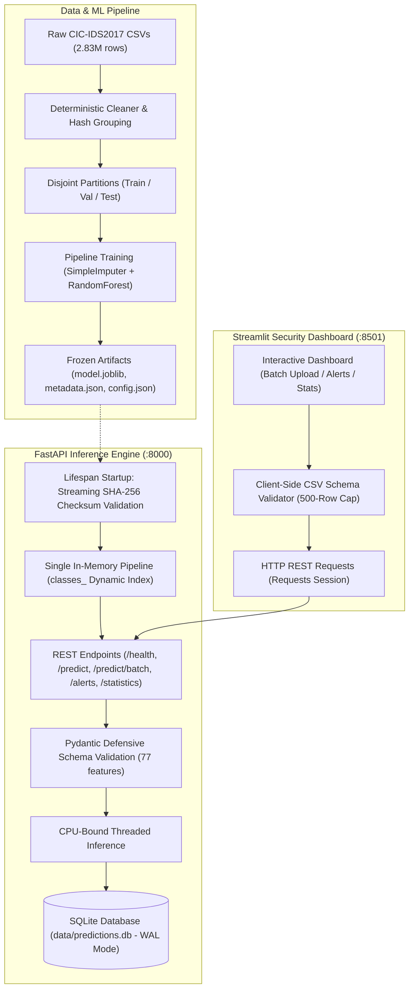

# AI-Based Network Intrusion Detection & Security Monitoring System

An offline, reproducible Network Intrusion Detection System (NIDS) evaluating 2.83 million flow records from the CIC-IDS2017 benchmark dataset. The system features a leak-free Random Forest classification pipeline, a high-performance FastAPI inference backend, and a decoupled Streamlit security monitoring dashboard.

---

## 1. Project Purpose & Operational Scope

### Purpose
This system is an academic engineering prototype designed to perform supervised binary classification on pre-extracted network flow records, distinguishing between legitimate background traffic (`BENIGN`, class 0) and network intrusions (`ATTACK`, class 1). It enables post-incident log analysis, security auditing, and detection performance benchmarking under realistic class imbalance.

### Explicit Operational Boundaries
> [!IMPORTANT]
> **What This System Is and Is NOT:**
> - **Passive IDS, NOT an IPS:** This system operates strictly out-of-band as an Intrusion Detection System. It classifies historical flow records and logs alerts into an SQLite database. It is **not** an Intrusion Prevention System (IPS); it cannot drop packets, inject `TCP RST` packets, terminate sockets, or modify firewall rules.
> - **Pre-Extracted Flow Records, NOT a Live Packet Sniffer:** The system processes tabular summary statistics (durations, packet counts, inter-arrival times, header lengths, window sizes) generated by flow extractors (e.g., CICFlowMeter / NetFlow). It does **not** interface with network interface controllers (NICs), promiscuous mode drivers (WinPcap/Npcap/libpcap), raw sockets, or real-time packet stream reassemblers.
> - **Offline Benchmark Scope:** The system evaluates static synthetic traffic from the CIC-IDS2017 benchmark. It does not provide real-time zero-day guarantees or online domain-drift compensation.

---

## 2. System Architecture

The project enforces a decoupled microservices architecture with strict separation between machine learning inference, API serving, data persistence, and UI presentation:



### Key Architectural Safeguards:
1. **Decoupled Frontend:** The Streamlit dashboard never imports `joblib`, never accesses SQLite files directly, and never runs model inference in its own process. It interacts with the backend strictly via HTTP REST.
2. **Cryptographic Model Boundary:** The FastAPI backend validates the streaming SHA-256 hash of `model.joblib` before deserialization. Client-supplied model paths or upload endpoints are strictly prohibited.
3. **Atomic Persistence:** Prediction records are inserted into SQLite wrapped in `BEGIN IMMEDIATE` / `COMMIT` transactions with automatic rollback on error.
4. **Dynamic Class Indexing:** The positive `ATTACK` probability column is resolved dynamically via `model.classes_` at startup, avoiding hardcoded column assumptions.

---

## 3. Prerequisites & Installation

### Environment Requirements
- **Operating System:** Windows 10 / 11 (64-bit AMD64) or Linux
- **Python Version:** Python 3.11.9 (tested with scikit-learn 1.9.1, numpy 2.4.6, pandas 2.2.3, fastapi 0.115.6, streamlit 1.41.1)
- **Available RAM:** Minimum 8 GB recommended for dataset preparation; runtime inference requires < 1 GB.

### Installation Steps

1. Clone or open the repository workspace:
   ```bash
   git clone https://github.com/<your-username>/network-intrusion-detection.git
   cd network-intrusion-detection
   ```

2. Create and activate a Python 3.11 virtual environment:
   ```powershell
   py -3.11 -m venv .venv
   ```

3. Upgrade pip and install pinned project dependencies:
   ```powershell
   .\.venv\Scripts\python.exe -m pip install --upgrade pip
   .\.venv\Scripts\pip install -r requirements.txt
   ```

4. Verify installation integrity:
   ```powershell
   .\.venv\Scripts\python.exe -m pytest -q
   ```
   *(66 automated tests should pass in approximately 15 seconds).*

---

## 4. Dataset Source & Third-Party Mirror Provenance Limitation

### Primary Publisher Information
- **Dataset:** CIC-IDS2017 (Canadian Institute for Cybersecurity, University of New Brunswick, Fredericton, Canada).
- **Official Documentation:** [https://www.unb.ca/cic/datasets/ids-2017.html](https://www.unb.ca/cic/datasets/ids-2017.html)
- **Primary Intake Portal:** Requires academic registration form.
- **Reference Citation:**
  > Iman Sharafaldin, Arash Habibi Lashkari, and Ali A. Ghorbani, *"Toward Generating a New Intrusion Detection Dataset and Intrusion Traffic Characterization"*, 4th International Conference on Information Systems Security and Privacy (ICISSP), Portugal, January 2018.

### Third-Party Mirror Provenance Limitation
- **Download Mirror:** Hugging Face repository [`bencorn/CICIDS2017`](https://huggingface.co/datasets/bencorn/CICIDS2017) (`MachineLearningCSV.zip`, 224.21 MB compressed, 843.66 MB extracted across 8 CSVs).
- **Cryptographic Provenance Disclaimer:** The original publisher (UNB) does **not** publish authoritative cryptographic SHA-256 signatures for the CSV distributions on its public portal. While local archive checks confirmed valid CRC-32 checksums and expected row structures, **bit-for-bit equivalence between this third-party mirror and UNB's original generation cannot be independently verified**.

---

## 5. Reproducible Preparation, Training, and Evaluation Commands

All data processing and training steps are automated via standalone CLI scripts.

> [!NOTE]
> In a pre-configured workspace with generated models and reports already present, **do not re-run these expensive stages**. They are documented below for complete scientific reproducibility from raw data.

### Step 1: Acquire Dataset
```powershell
.\.venv\Scripts\python.exe scripts/acquire_dataset.py
```
*Downloads `MachineLearningCSV.zip`, validates ZIP integrity, and safely extracts all 8 CSVs into `data/raw/cicids2017/`.*

### Step 2: Comprehensive Dataset Audit
```powershell
.\.venv\Scripts\python.exe scripts/audit_dataset.py --input-dir data/raw/cicids2017 --output-dir reports/generated
```
*Inspects headers, quantifies duplicate columns, counts 4,376 infinite values, and records label distributions without exceeding available RAM.*

### Step 3: Leakage-Aware Preprocessing & Group Splitting
```powershell
.\.venv\Scripts\python.exe scripts/prepare_dataset.py --raw-dir data/raw/cicids2017
```
*Cleans features, drops redundant secondary `Fwd Header Length` at 0-based index 55 (1-based column 56; verified identical to 0-based index 34 / 1-based column 35), computes SHA-256 fingerprints on canonical IEEE 754 uint64 float vectors, and assigns partitions using salted SHA-256 hashing to generate strictly disjoint train/val/test parquet shards in `data/processed/v1/`.*

### Step 4: Baseline Model Training & Comparison
```powershell
.\.venv\Scripts\python.exe scripts/train_baselines.py
```
*Samples 150k train rows and 50k val rows; fits Dummy, Logistic Regression, Decision Tree, and Random Forest; serializes the winning Random Forest pipeline to `models/baseline_v1/model.joblib`.*

### Step 5: Validation Threshold Tuning & Held-Out Test Evaluation
```powershell
.\.venv\Scripts\python.exe scripts/evaluate_phase6b.py
```
*Scores the full 417k-row validation split; freezes threshold `0.29` into `models/baseline_v1/frozen_evaluation_config.json`; evaluates the frozen model ONCE on the 416k-row held-out test split; exports evaluation reports.*

### Step 6: Runtime Artifact Preflight Verification
```powershell
.\.venv\Scripts\python.exe scripts/check_runtime_artifacts.py
```
*Inspects model SHA-256, frozen configs, 77-feature schemas, demo CSV, and database permissions without deserializing untrusted joblib weights.*

---

## 6. Required Runtime Artifacts

To run the inference API and dashboard, the following files must exist locally:

| File Path | Description | Checksum / Property |
| :--- | :--- | :--- |
| `models/baseline_v1/model.joblib` | Serialized Scikit-learn Pipeline (SimpleImputer + RandomForest) | SHA-256: `4339282ba6ce68b5c44c6dd6a72e7796e755a77542d65021984dd1a8b0434793` |
| `models/baseline_v1/metadata.json` | Model metadata, training timestamp, dependencies, 77 feature names | Feature count: 77 |
| `models/baseline_v1/frozen_evaluation_config.json` | Frozen decision threshold and operating rule | Threshold: `0.29` |
| `reports/generated/test_evaluation.json` | Held-out test evaluation report | 416,144 test flows evaluated |
| `data/demo/example_flows.csv` | Benchmark verification CSV | 10 valid network flows (77 features) |
| `data/predictions.db` | SQLite database (auto-created on startup) | Prediction history & alerts |

> [!IMPORTANT]
> **Source-Only Checkouts:** In a fresh source-only repository checkout where large binary model weights (`models/**/*.joblib`) are excluded by `.gitignore`, you must execute Steps 3, 4, and 5 above to generate the model artifact before starting the servers. Small evaluation summaries are preserved for inspection under `docs/results/`.

---

## 7. Local Startup Using Two Terminals (Verified Procedure)

Due to Windows default `Restricted` PowerShell script execution policies, running `.ps1` scripts directly can fail with `PSSecurityException`. Modifying global execution policies is discouraged. 

The **verified, standard startup procedure** executes Python directly in two separate terminals without modifying any system execution policy:

### Terminal 1: Start FastAPI Backend
Open a PowerShell terminal in the workspace root and run:
```powershell
.\.venv\Scripts\python.exe -m uvicorn app.api.main:app --host 127.0.0.1 --port 8000
```
- **Bound Address:** `127.0.0.1:8000` (loopback only; not exposed to external networks).
- **Startup Actions:** Automatically runs pre-flight SHA-256 verification, loads the model once, resolves `model.classes_`, and initializes the SQLite schema.

### Terminal 2: Start Streamlit Dashboard
Open a second PowerShell terminal in the workspace root and run:
```powershell
.\.venv\Scripts\python.exe -m streamlit run app/dashboard/main.py --server.address 127.0.0.1 --server.port 8501
```
- **Bound Address:** `127.0.0.1:8501` (loopback only).
- **Access URL:** Open your browser at `http://127.0.0.1:8501`.

---

## 8. Dashboard Usage & API Request Format

### Implemented FastAPI Endpoints

| Method | Endpoint | Description |
| :--- | :--- | :--- |
| `GET` | `/health` | Service liveness, model loaded status, SQLite connectivity. |
| `GET` | `/model/info` | Loaded model version, 77 feature names, class mapping, threshold (`0.29`). |
| `POST` | `/predict` | Single flow inference; records prediction in SQLite; returns label & probability. |
| `POST` | `/predict/batch` | Batch flow inference (1 to 500 flows); records history atomically; returns list of predictions. |
| `GET` | `/alerts` | Paginated query of stored `ATTACK` detections (`limit`, `offset`, `start_time`, `end_time`). |
| `GET` | `/statistics` | Historical classification totals, benign/attack counts, attack proportion. |

*(Note: There is no `/history` endpoint; historical records are accessed via `/alerts` and `/statistics`).*

### API Request Examples

#### Single Flow Request (`POST /predict`):
```json
{
  "features": {
    "Destination Port": 80.0,
    "Flow Duration": 1293792.0,
    "Total Fwd Packets": 3.0,
    "...": "...",
    "Idle Min": 0.0
  }
}
```
*Response (`HTTP 200`):*
```json
{
  "prediction_id": "7f8b3c2e-4b61-419b-bc77-94a50d24bf98",
  "timestamp_utc": "2026-10-13T01:00:00.000000+00:00",
  "prediction_label": "ATTACK",
  "attack_probability": 0.98,
  "decision_threshold": 0.29,
  "model_version": "baseline_v1"
}
```

#### Batch Request (`POST /predict/batch`):
```json
{
  "flows": [
    {"features": {"Destination Port": 54865.0, "...": "..."}},
    {"features": {"Destination Port": 80.0, "...": "..."}}
  ]
}
```

### Dashboard Features & Validation Boundaries
- **Batch CSV Analysis:** Upload `data/demo/example_flows.csv` (10 flows) or `data/demo/example_flows_1000.csv` (1,000 flows) to score flows, display probabilities, and generate color-coded detection badges.
- **Sequential Chunking (up to 1,000 Flows):** Uploads up to 1,000 rows are validated entirely upfront, then automatically dispatched in sequential batches of $\le 500$ flows matching the backend `POST /predict/batch` limit. Progress is reported live, results are combined in original input order, and results persist across session state rerenders without duplicate API calls.
- **Client-Side CSV Validation vs. API HTTP 422:**
  - *Client-Side:* When uploading via the dashboard, `app/dashboard/csv_utils.py` validates headers and rows locally before sending any network traffic. If a CSV has missing columns, extra columns, non-numeric strings, or $> 1,000$ rows, it is intercepted and rejected in the browser UI. **No network request is issued to FastAPI, so no HTTP 422 status code is generated.**
  - *Server-Side HTTP 422:* The FastAPI backend independently validates raw payloads via Pydantic. If an external client (e.g. cURL, Python script) directly posts an invalid payload to `POST /predict` or `POST /predict/batch`, the backend returns `HTTP 422 (Unprocessable Content)`.
- **Single Flow Tester:** Fill in key flow features to test individual flow vectors interactively.
- **Alerts Feed:** Filter and inspect stored `ATTACK` alerts with pagination.
- **Historical Statistics:** Real-time summary counts of benign vs. attack classifications.

---

## 9. Automated Testing

The project includes an extensive test suite across 8 modules:

```powershell
.\.venv\Scripts\python.exe -m pytest -v
```

### Test Coverage Summary (66 Tests):
- [`tests/test_preflight.py`](tests/test_preflight.py) (4 tests): Model checksum verification, threshold validation, schema consistency, database directory permissions, and demo file checks.
- [`tests/test_api.py`](tests/test_api.py) (13 tests): Route handlers, Pydantic type strictness, rejection of booleans and string numbers, batch bounds (1-500), atomic persistence.
- [`tests/test_dashboard.py`](tests/test_dashboard.py) (21 tests): CSV header whitespace stripping, duplicate detection, demo CSV contracts (10-row and 1,000-row), 1,000-row validation boundary, sequential chunking (500 flows each), input ordering preservation, partial failure retention without retry, session state persistence.
- [`tests/test_temp_db_1000_flows.py`](tests/test_temp_db_1000_flows.py) (2 tests): End-to-end integration test verifying that scoring all 1,000 flows from `example_flows_1000.csv` inserts exactly 1,000 records in an isolated temporary database, leaving production history untouched, and stops without retry on partial failure.
- [`tests/test_preprocess.py`](tests/test_preprocess.py) (9 tests): Fingerprint hashing uniqueness, missing vs zero separation, infinity conversion idempotency, partition disjointness.
- [`tests/test_train.py`](tests/test_train.py) (6 tests): Pipeline fitting, median imputation encapsulation, sample reproducibility.
- [`tests/test_evaluate.py`](tests/test_evaluate.py) (6 tests): Dynamic class index resolution, confusion matrix calculations, operating rule threshold selection.
- [`tests/test_audit.py`](tests/test_audit.py) (5 tests): Header parsing, duplicate column verification, non-numeric counting.

---

## 10. Docker Configuration & Current Engine Blocker

### Container Packaging Files
- [`Dockerfile.api`](Dockerfile.api): Based on `python:3.11-slim`, running as non-root user `appuser` (UID 1000), listening on port 8000.
- [`Dockerfile.dashboard`](Dockerfile.dashboard): Based on `python:3.11-slim`, running as non-root user `appuser` (UID 1000), listening on port 8501.
- [`.dockerignore`](.dockerignore): Excludes `.git`, `.venv`, bulk datasets (`raw/`, `processed/`), databases, and caches.
- [`docker-compose.yml`](docker-compose.yml): Loopback publication (`127.0.0.1:8000`, `127.0.0.1:8501`), read-only mounts for models and reports, persistent named volume `nids_db_data`.

### Static Validation
The Docker Compose configuration was statically validated using the installed Docker CLI:
- **Executable Path:** `C:\Program Files\Docker\Docker\resources\bin\docker.exe`
- **Docker CLI Version:** `Docker version 29.6.1, build 8900f1d`
- **Compose CLI Version:** `Docker Compose version v5.3.0`
- **Static Validation Command:** `docker compose config` passed with exit code 0.

### Current Engine Blocker
> [!WARNING]
> **Docker Daemon Status: Blocked**
> When polling `docker info`, the Windows Docker Desktop daemon failed to respond (`failed to connect to docker API at npipe:////./pipe/dockerDesktopLinuxEngine`). 
> In accordance with safety rules, no Windows virtualization settings, WSL configurations, or administrative prompts were modified. 
> Therefore, **live container image builds, Linux runtime library compatibility, and container volume persistence remain unverified in this environment**. Use the verified [Local Two-Terminal Startup](#7-local-startup-using-two-terminals-verified-procedure).

---

## 11. Model Evaluation Results & Critical Limitations

### Population Distinctions
To maintain strict scientific integrity, different data subsets must be clearly distinguished:
- **Full Benchmark Collection:** 2,830,743 rows across 8 CSV files.
- **Model Training Sample:** 150,000 deterministic stratified rows (119,776 Benign, 30,224 Attack).
- **Model Comparison Validation Sample:** 50,000 deterministic stratified rows (40,811 Benign, 9,189 Attack).
- **Threshold Selection Population:** Full validation partition of **417,395 rows** across 8 shards.
- **Held-Out Test Population:** Full test partition of **416,144 rows** across 8 shards (evaluated **once**).

### Held-Out Test Evaluation Results (416,144 Rows)

| Metric | Frozen Threshold (0.29) | Default Threshold (0.50) |
| :--- | :--- | :--- |
| **Precision (ATTACK)** | **99.17%** (`0.991723`) | **99.61%** (`0.996060`) |
| **Recall (ATTACK)** | **99.73%** (`0.997308`) | **99.29%** (`0.992860`) |
| **F1-Score (ATTACK)** | **99.45%** (`0.994507`) | **99.45%** (`0.994457`) |
| **Accuracy** | **99.80%** (`0.997965`) | **99.80%** (`0.997955`) |
| **False Positive Rate (FPR)** | **0.1886%** (`0.001886`) | **0.0890%** (`0.000890`) |
| **False Negative Rate (FNR)** | **0.2692%** (`0.002692`) | **0.7140%** (`0.007140`) |
| **Average Precision (AP)** | **0.9996** (`0.999642`) | **0.9996** (`0.999642`) |
| **Confusion Matrix** | **TN:** 338,616 \| **FP:** 640<br>**FN:** 207 \| **TP:** 76,681 | **TN:** 338,954 \| **FP:** 302<br>**FN:** 549 \| **TP:** 76,339 |

> [!NOTE]
> **Average Precision vs. Trapezoidal PR-AUC:** The implementation computes Average Precision (AP) via Scikit-learn's `average_precision_score` ($AP = \sum_n (R_n - R_{n-1}) P_n$). This is the weighted mean of precisions at each threshold, distinct from trapezoidal PR-AUC ($\int P(R) dR$ via the trapezoidal rule).

### Per-Attack Category Recall Breakdown (Post-Hoc Evaluation Metadata)
*Note: The model is strictly binary at inference. Threat categories are evaluated post-hoc using ground-truth metadata.*

| Threat Category | Test Total Rows | Detected at Threshold 0.29 | Recall (0.29) | Detected at Default 0.50 | Recall (0.50) |
| :--- | :--- | :--- | :--- | :--- | :--- |
| **BENIGN (Specificity)** | 339,256 | 338,616 | **99.81%** | 338,954 | **99.91%** |
| **PortScan** | 23,897 | 23,893 | **99.98%** | 23,886 | 99.95% |
| **DDoS** | 19,305 | 19,282 | **99.88%** | 19,270 | 99.82% |
| **DoS Hulk** | 27,679 | 27,645 | **99.88%** | 27,543 | 99.51% |
| **SSH-Patator** | 773 | 771 | **99.74%** | 763 | 98.71% |
| **DoS Slowhttptest** | 812 | 808 | **99.51%** | 801 | 98.65% |
| **DoS GoldenEye** | 1,581 | 1,572 | **99.43%** | 1,548 | 97.91% |
| **FTP-Patator** | 1,416 | 1,416 | **100.00%** | 1,320 | 93.22% |
| **DoS slowloris** | 807 | 807 | **100.00%** | 779 | 96.53% |
| **Web Attack - XSS** | 93 | 92 | **98.92%** | 89 | 95.70% |
| **Web Attack - Brute Force** | 230 | 223 | **96.96%** | 206 | 89.57% |
| **Bot** | 289 | 172 | **59.52%** | 134 | **46.37%** |
| **Infiltration** | 3 | 0 | **0.00%** | 0 | 0.00% |
| **Web Attack - Sql Injection** | 2 | 0 | **0.00%** | 0 | 0.00% |
| **Heartbleed** | 1 | 0 | **0.00%** | 0 | 0.00% |

### Critical Limitations
1. **Botnet Detection Weakness:** Ares Botnet recall is only **59.52%** (172 / 289 detected). Bot traffic consists of lightweight C2 polling whose flow metrics heavily overlap with legitimate HTTP traffic.
2. **Rare-Class Statistical Uncertainty:** Attacks with $\le 3$ examples in the test split (`Heartbleed`, `Infiltration`, `SQL Injection`) were completely missed. Due to sample scarcity, empirical recall has high variance and does not establish generalizability.
3. **Repeated-Row Weighting:** High aggregate accuracy is dominated by voluminous DoS and PortScan attacks. Rare targeted attacks represent a fraction of the benchmark rows.
4. **Unresolved Label Conflicts:** The dataset audit revealed 1,358 duplicate feature vectors that have conflicting labels in the source data.
5. **Uncalibrated Output Probabilities:** Scikit-learn Random Forest output probabilities represent tree voting proportions, not mathematically calibrated posterior probabilities.

---

## 12. Troubleshooting

### Port Already in Use (8000 or 8501)
If starting either server fails with an address already in use error:
```powershell
Get-NetTCPConnection -LocalPort 8000, 8501 -ErrorAction SilentlyContinue | Select-Object LocalPort, OwningProcess
```
Terminate the conflicting process or change the port in `.env` (`API_PORT=8001`, `BACKEND_API_URL=http://127.0.0.1:8001`).

### Missing Model Weights in Fresh Checkout
If `check_runtime_artifacts.py` fails reporting missing `models/baseline_v1/model.joblib`:
- Large binary weights are excluded by `.gitignore` to keep repositories light.
- Regenerate the model artifact by running:
  ```powershell
  .\.venv\Scripts\python.exe scripts/train_baselines.py
  .\.venv\Scripts\python.exe scripts/evaluate_phase6b.py
  ```

### PowerShell Execution Policy Error
If attempting to run a `.ps1` script produces:
`File ... cannot be loaded because running scripts is disabled on this system.`
- **Do NOT alter system execution policies.**
- Use the verified two-terminal commands directly calling `.\.venv\Scripts\python.exe`.

### Model Checksum Mismatch
If FastAPI fails during startup with `Model checksum mismatch`:
- The binary `models/baseline_v1/model.joblib` has been modified or re-trained without updating `frozen_evaluation_config.json`.
- Run `scripts/check_runtime_artifacts.py` to inspect the recorded vs actual SHA-256 hash.

---

## Documentation Index
- [`docs/MODEL_CARD.md`](docs/MODEL_CARD.md): Comprehensive model details, dataset provenance, training methodology, threshold selection, and limitations.
- [`docs/DEMO_GUIDE.md`](docs/DEMO_GUIDE.md): 5-minute live demonstration script with preflight checks and step-by-step walkthrough.
- [`docs/INTERVIEW_PREP.md`](docs/INTERVIEW_PREP.md): 60-second pitch, 3 truthful resume bullets, and 15 technical interview questions and answers.
- [`docs/PROJECT_STATUS.md`](docs/PROJECT_STATUS.md): Explicit verification checklist distinguishing verified components from pending environment boundaries.
- [`docs/results/`](docs/results/): Small preserved evaluation reports, threshold curves, confusion matrices, and metrics.
